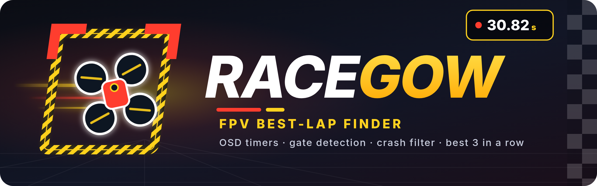
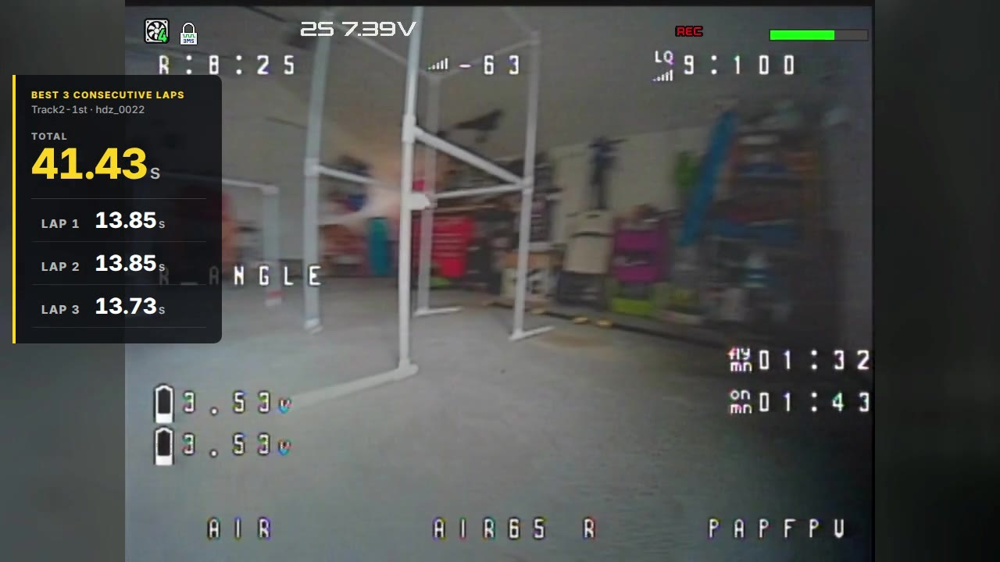
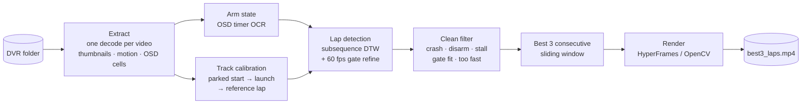

<p align="center">
  
</p>

<p align="center">
  <b>Drop in a folder of raw FPV race recordings. Get back your fastest 3 consecutive clean laps,<br>
  timed to the frame and exported as a clip with a lap-time overlay.</b>
</p>

<p align="center">
  
  
  
  
  
  
</p>

---

## Why

Tiny-whoop racing (like the [RaceGOW](https://www.racegow.com/) format) is scored on your **best 3
consecutive laps**. Finding them by hand means scrubbing through every DVR recording, frame-stepping
every gate pass, and throwing out every lap where you clipped a pole. With a dozen packs that is an
evening of work.

**Racegow does it automatically:**

| | |
|---|---|
| ⏱️ **Reads your OSD** | Finds a Betaflight `mm:ss` timer anywhere on screen (one is enough), reads it with template OCR, and knows exactly when you were armed. |
| 🚩 **Learns the start gate** | No track setup. It spots the parked start position in each recording, learns the lap from how the footage repeats, and pins the timing line on the start gate. Works on any layout. |
| 💥 **Throws out crashes** | Off-line laps, disarms, stalls, missed gates and impossibly fast "laps" are rejected, each with a reason. |
| 🏁 **Best 3 in a row** | A sliding window over every clean lap in every video, ranked globally. |
| 🎬 **Exports the highlight** | Frame-accurate cut with a live lap clock, lap 1/2/3 and total, aligned on the left edge. Rendered with HyperFrames, or pure OpenCV when Node isn't installed. |
| 🤖 **Works with your AI agent** | Ships as an Agent Skill: ask Claude Code, Codex or any coding agent *"find my best 3 laps in this folder"*. |

<p align="center">
  
  <br><sub>Real output: 11 recordings, 36 minutes of footage, 154 laps found, 101 clean. Best: 10.27 + 10.33 + 10.22 = <b>30.82 s</b>.</sub>
</p>

---

## Quick start

```bash
git clone https://github.com/irom77/Racegow.git
cd Racegow

python3 -m venv .fpvlaps-venv
.fpvlaps-venv/bin/pip install -r skills/fpv-best-laps/scripts/requirements.txt
.fpvlaps-venv/bin/python skills/fpv-best-laps/scripts/fpvlaps.py doctor

# analyze + export in one go
.fpvlaps-venv/bin/python skills/fpv-best-laps/scripts/fpvlaps.py run --videos /path/to/your/dvr/folder
```

You get `fpvlaps-work/<folder>/report.md` with the result and runners-up, `laps.csv` with every lap,
verification images in `sheets/`, and the clip in `export/best3_laps_<video>_<total>s.mp4`.

Prefer to check before rendering? Run `analyze` first, look at `sheets/rank1_crossings.jpg` (all four
gate crossings should show the same spot), then `render --rank 1`.

### Use it from an AI coding agent

Link the skill folder where your agent looks for skills:

```bash
ln -s "$PWD/skills/fpv-best-laps" ~/.claude/skills/fpv-best-laps   # Claude Code
ln -s "$PWD/skills/fpv-best-laps" ~/.codex/skills/fpv-best-laps    # OpenAI Codex CLI
ln -s "$PWD/skills/fpv-best-laps" ~/.agents/skills/fpv-best-laps   # shared .agents convention
```

Then, in any repository: *"Find my fastest 3 consecutive laps in D:\FPV\Track2 and export the clip."*
The agent runs the analysis, checks the verification images, corrects the gate if needed, renders
and reports the lap table. Other agents (Cursor, Gemini CLI, Aider...) can be pointed at
`skills/fpv-best-laps/SKILL.md` from their rules file.

---

## How it works



Every heavy pixel operation happens once, in **Extract**, and is cached. Re-analysis after a
correction takes a minute or two instead of another full decode.

The full architecture (module map, calibration and filter flowcharts, data flow, tunables,
validation and limits) is in the **[skill README](skills/fpv-best-laps/README.md)**, and the
detailed method is in [`references/method.md`](skills/fpv-best-laps/references/method.md).

---

## Accuracy

On the test session (HDZero, 1280×720 at 60 fps), the fully automatic run picked the same three
laps as careful manual frame-stepping: **30.82 s** automatic vs **30.77 s** manual. The small
difference comes from the automatic timing line sitting on the start spot just in front of the gate.
Per-crossing accuracy is about ±2–3 frames (±0.05 s at 60 fps).

---

## Repository layout

```
Racegow/
├── skills/fpv-best-laps/      ← the product: agent skill + CLI (start here)
│   ├── SKILL.md               agent instructions
│   ├── README.md              full architecture and usage
│   ├── scripts/fpvlaps.py     CLI: doctor · run · extract · analyze · render
│   ├── scripts/fpvlaps/       pipeline package
│   ├── references/method.md   detailed method and tunables
│   └── assets/                OSD digit templates, HyperFrames overlay, fonts
├── src/                       original single-track prototype (hard-coded paths, superseded by the skill)
├── export/                    HyperFrames project used for the first hand-verified export
│   ├── index.html             overlay composition
│   └── snapshots/             preview frames
└── docs/                      logo and README images
```

`export/index.html` expects its clip at `export/assets/best3_raw.mp4`, which is not committed
(videos are git-ignored). The skill's `render` command generates everything it needs on its own.

---

## Requirements

- **Python 3.9+** with `opencv-python-headless`, `numpy`, `imageio-ffmpeg` (ffmpeg is bundled).
- **Optional:** Node.js 18+ plus `ffmpeg`/`ffprobe` on PATH for the HyperFrames renderer. Without
  them the OpenCV renderer produces the same layout.
- **Footage:** each recording should start with the quad parked in front of the start gate. One OSD
  `mm:ss` timer, anywhere on screen, gives the most reliable crash/disarm detection; without one,
  motion is used instead.

---

## References

- [RaceGOW](https://www.racegow.com/): the FPV whoop racing competition that inspired this project (rules, tracks, leaderboards).
- [RaceGOW Track Visualizer](https://racegow.geddyv.lt/track-visualizer/): community tool for viewing RaceGOW track layouts.
- [Video Lap Tracking Lab](https://zerotasteguy.github.io/vltl/): browser tool for marking lap times frame by frame in a video, comparing laps and exporting CSV/JSON. Handy for spot-checking results by hand.

---

<p align="center"><sub>
Independent open-source project, inspired by the <a href="https://www.racegow.com/">RaceGOW</a> tiny-whoop racing format.
Not affiliated with or endorsed by RaceGOW. Released under the <a href="LICENSE">MIT License</a>.
</sub></p>
