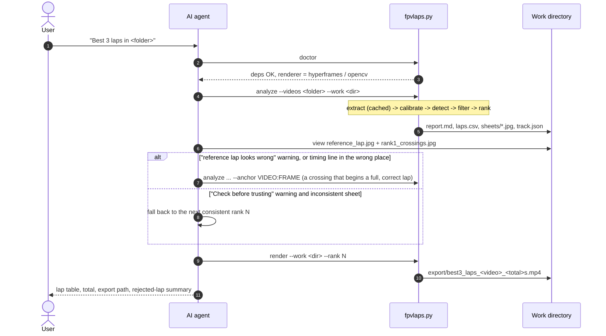
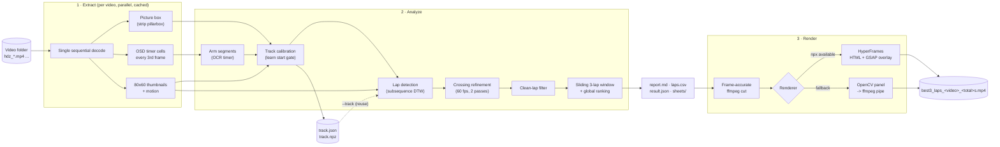
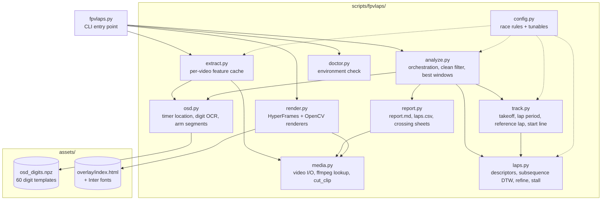
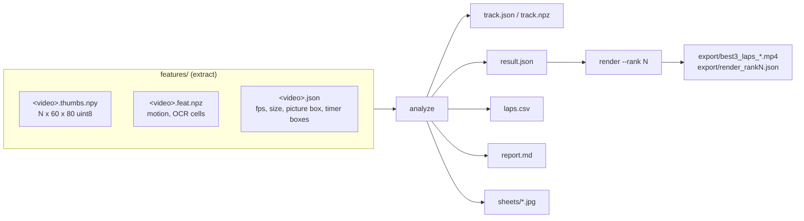
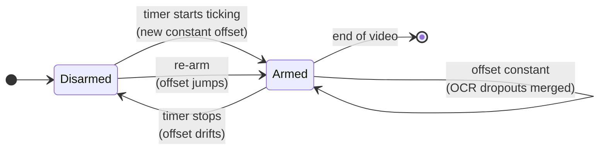
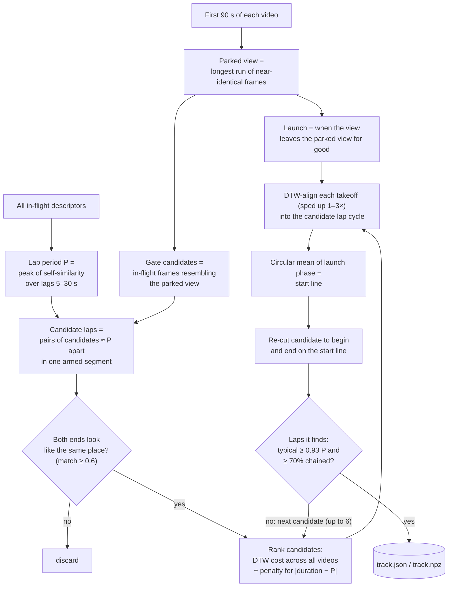
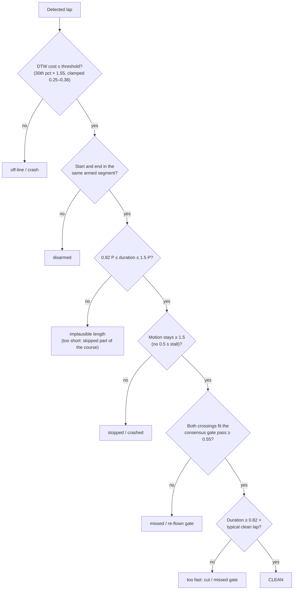
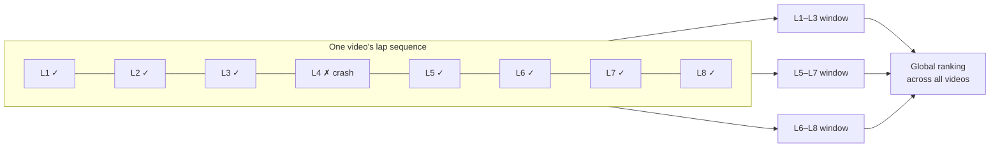
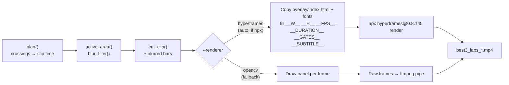

# fpv-best-laps

Point it at a folder of raw FPV race recordings. It finds the **fastest 3 consecutive clean laps**
across all of them and exports that stretch as an MP4, with the total and each lap time overlaid on
the **left edge** of the frame.

It is two things in one folder:

- **An agent skill.** `SKILL.md` tells an AI coding agent (Claude Code, Codex, Cursor, Gemini CLI,
  and others) how to run the analysis, check the result and report back.
- **A standalone command-line tool.** `scripts/fpvlaps.py` does all the work. It needs no agent and
  runs from any terminal.

Nothing is hard-coded to one track. The start gate, the racing line and the lap length are learned
from the footage each time, so the same skill works on any RaceGOW (or other whoop) layout.

---

## Contents

1. [What you get](#what-you-get)
2. [Race rules](#race-rules)
3. [Install](#install)
4. [Usage](#usage)
5. [Architecture](#architecture)
6. [How each stage works](#how-each-stage-works)
7. [Output files](#output-files)
8. [Tuning](#tuning)
9. [Validation](#validation)
10. [Limitations](#limitations)
11. [Troubleshooting](#troubleshooting)
12. [Repository layout](#repository-layout)

---

## What you get

A single run over a folder produces:

| Output | What it is |
|---|---|
| `export/best3_laps_<video>_<total>s.mp4` | Frame-accurate cut of the winning 3 laps (1 s padding each side, original audio), with a left-aligned overlay: a live lap clock, lap 1/2/3 times and the total. |
| `report.md` | The result table, the top-5 runners-up with source frames and timestamps, warnings, and a per-video summary. |
| `laps.csv` | Every lap detected in every video, marked clean or rejected, with the reason. |
| `sheets/*.jpg` | Contact sheets of the gate crossings, so a person (or an agent that can view images) can confirm the timing line is in the right place. |
| `track.json` + `track.npz` | The learned track profile. Reuse it for later sessions on the same layout. |

Example `report.md` result, from 11 HDZero recordings (36 min of footage):

| Lap | Time | Frames | Video time |
|---|---|---|---|
| 1 | **10.27s** | 5794 -> 6410 | 96.57s -> 106.83s |
| 2 | **10.33s** | 6410 -> 7030 | 106.83s -> 117.17s |
| 3 | **10.22s** | 7030 -> 7643 | 117.17s -> 127.38s |
| **Total** | **30.82s** | | |

---

## Race rules

These are fixed by the skill and are not configuration options:

| Rule | How it is enforced |
|---|---|
| A result is **exactly 3 consecutive laps** in one recording | `LAPS_PER_RESULT = 3` in `config.py`. Lap *n+1* must start at the exact crossing where lap *n* ended. |
| Laps start and end at the **start gate** | The timing line is learned from the parked start position, then every crossing is aligned to a consensus "gate pass" template. |
| **Clean laps only** | Six independent checks (off-line, disarm, duration, stall, gate fit, too fast). One failure rejects the lap. |
| **Best = minimum 3-lap total** | Sliding window over every video's lap sequence; all windows ranked globally. |
| Overlay **left-aligned on the left edge** | Both renderers draw one left-anchored panel; nothing is centred or right-aligned. |

---

## Install

### 1. Make the skill visible to your agent

The folder follows the open Agent Skills layout (`SKILL.md` with `name` and `description`
frontmatter). Put the folder, or a symlink to it, wherever your agent looks for skills:

| Agent | Location |
|---|---|
| Claude Code | `~/.claude/skills/fpv-best-laps/` (all projects) or `<repo>/.claude/skills/fpv-best-laps/` |
| OpenAI Codex CLI | `~/.codex/skills/fpv-best-laps/` or `<repo>/.codex/skills/fpv-best-laps/` |
| Agents using the shared `.agents` convention | `~/.agents/skills/fpv-best-laps/` |
| Anything else (Cursor, Aider, Gemini CLI, ...) | Anywhere. Reference it from the agent's rules file (`AGENTS.md`, `.cursorrules`, `GEMINI.md`): *"For FPV lap timing, follow /path/to/fpv-best-laps/SKILL.md"* |

```bash
git clone <this repo> ~/skills-src          # or copy the folder
ln -s ~/skills-src/fpv-best-laps ~/.claude/skills/fpv-best-laps
ln -s ~/skills-src/fpv-best-laps ~/.codex/skills/fpv-best-laps
ln -s ~/skills-src/fpv-best-laps ~/.agents/skills/fpv-best-laps
```

### 2. Python environment

```bash
python3 -m venv .fpvlaps-venv
.fpvlaps-venv/bin/pip install -r fpv-best-laps/scripts/requirements.txt   # Windows: .fpvlaps-venv\Scripts\pip
.fpvlaps-venv/bin/python fpv-best-laps/scripts/fpvlaps.py doctor
```

| Requirement | Needed for |
|---|---|
| Python 3.9+, `opencv-python-headless`, `numpy`, `imageio-ffmpeg` | Everything. `imageio-ffmpeg` ships an ffmpeg binary, so no system ffmpeg is needed for the core pipeline. |
| Node.js 18+ (`npx`), `ffmpeg` and `ffprobe` on PATH | Optional: the HyperFrames renderer (nicer typography, GSAP-animated overlay). Without these, the built-in OpenCV renderer produces the same layout. |

`doctor` checks every dependency and prints which renderer will be used.

---

## Usage

### With an agent

From any repository, ask in plain words:

> *Find my best 3 consecutive laps in C:\Users\me\Videos\RaceGOW\Track2 and export the clip.*

The skill triggers on lap timing, best laps, consecutive laps, lap overlays, RaceGOW, whoop races
or a folder of `hdz_*.mp4` files. The agent then follows `SKILL.md`:



The verification stop (steps 6–8) matters: the start gate is learned, not given, so a quick look at
two images before a multi-minute render catches the rare wrong calibration.

### From the command line

```bash
PY=.fpvlaps-venv/bin/python
CLI=fpv-best-laps/scripts/fpvlaps.py

$PY $CLI run     --videos /path/to/videos                 # everything, no verification stop
$PY $CLI analyze --videos /path/to/videos --work ./w      # extract + analyze only
$PY $CLI render  --work ./w --rank 1                      # export a verified rank
```

| Command | Does |
|---|---|
| `doctor` | Checks Python packages, ffmpeg/ffprobe and npx, and reports the renderer. |
| `extract` | Feature extraction only (the slow part; cached). |
| `analyze` | `extract` + track calibration + lap detection + ranking + reports. |
| `render` | Cuts and overlays one ranked result. |
| `run` | `analyze` + `render` in one go. |

| Option | Default | Meaning |
|---|---|---|
| `--videos DIR` | – | Folder of recordings (`.mp4 .mov .mkv .avi .ts .m4v`), one session per file. Under WSL use `/mnt/c/...`. |
| `--work DIR` | `./fpvlaps-work/<folder name>` | Cache and output folder. |
| `--track PROFILE.json` | – | Reuse a saved track profile instead of calibrating. |
| `--anchor VIDEO:FRAME` | – | Manual start-gate crossing, e.g. `hdz_0024:1596`. Overrides auto calibration. |
| `--workers N` | cores / 3 | Videos decoded in parallel during extraction. |
| `--rank N` | 1 | Which ranked result to render. |
| `--renderer` | `auto` | `auto`, `hyperframes` or `opencv`. |
| `--lead S` | 1.0 | Seconds of footage kept before the first and after the last crossing. |
| `--title TEXT` | `<folder> · <video>` | Overlay subtitle. |
| `--background` | `blur` | `blur` fills the black side bars (4:3 footage in a 16:9 frame) with a blurred, dimmed copy of the footage. `black` keeps the bars. |
| `--blur-strength PX` | 40 | Blur radius of that background. |

**Timing** (measured on 36 min of 720p60 HEVC, 22-core machine, reading a Windows drive from WSL):

| Step | Time |
|---|---|
| First extraction | ~15 min |
| Re-analysis on cached features (e.g. after `--anchor`) | 1–3 min |
| Render, HyperFrames | 5–12 min for a 33 s clip (CPU only) |
| Render, OpenCV | 3–10 min |

---

## Architecture

### Pipeline overview



All heavy pixel work happens once, in **Extract**. Every later stage runs on the cached
thumbnails and OCR cells, which is why re-analysis is cheap and corrections such as `--anchor`
take minutes, not another full decode.

### Module map



| Module | Responsibility |
|---|---|
| `config.py` | `LAPS_PER_RESULT = 3` and every threshold, in one place. |
| `media.py` | Lists videos, finds ffmpeg (PATH or `imageio-ffmpeg`), reads frames, makes the frame-accurate cut. |
| `osd.py` | Finds the `mm:ss` timers, classifies digits against templates, turns timer readings into armed segments. |
| `extract.py` | One decode per video; writes `<video>.thumbs.npy`, `<video>.feat.npz`, `<video>.json`. |
| `laps.py` | Picture descriptors, subsequence DTW, 60 fps crossing refinement, stall detection. |
| `track.py` | Learns the layout: parked view, launch, lap period, reference lap, start-line shift. |
| `analyze.py` | Runs calibration and detection, applies the clean rules, builds and ranks 3-lap windows, writes `result.json`. |
| `report.py` | Human-readable report, CSV, verification contact sheets. |
| `render.py` | Plans the clip, cuts it, draws the overlay with HyperFrames or OpenCV. |
| `doctor.py` | Dependency and renderer check. |

### Data flow through the work directory



`result.json` is the contract between analysis and rendering. It holds the fps, the lap period,
the reference lap, every lap with its verdict, and the ranked best windows, so `render` never
needs to re-run any vision code.

---

## How each stage works

The full method, with every rule and constant, is in [`references/method.md`](references/method.md).
This section is the overview.

### 1. Feature extraction

Each video is decoded **once**, sequentially (seeking in HEVC is slow and imprecise). Before the
decode, 48 sampled frames are used to locate:

- **The picture box:** the non-black area, which removes 4:3 pillarbox bars from 16:9 recordings.
- **The OSD timers:** persistent white glyphs (grey > 190) anywhere in the frame are searched for a
  colon, i.e. two stacked dots. The dot spacing sets the glyph scale (18 px at 720p), so any
  resolution and any OSD position works. A candidate must read as a valid `mm:ss` in at least 30% of
  the samples and show at least 3 different values, which rejects static text such as `3.50v`.

During the decode, each frame contributes an 80×60 greyscale thumbnail of the picture (OSD bands
masked out), a motion value (mean absolute frame difference), and, every 3rd frame, the 4 digit
cells of each timer.

### 2. OSD timers → armed segments

Digits are classified against 60 hand-labelled templates (k-means centroids of real Betaflight
digits, plus "clutter" classes), allowing ±2 px shifts. A flight timer runs at exactly 1 s per
second **only while armed**, so the value *timer − video time* is constant during a flight and
changes when the quad is disarmed or re-armed:



**One timer is enough.** A per-arm timer (resets on arm) and a total-armed timer (pauses while
disarmed) both work; the per-arm one also reveals a quick disarm-rearm after a crash. With several
timers on screen, the one that yields the most armed segments is used, so a power-on timer (which
never pauses) never wins over an armed one. On the test session, timer 1 alone, timer 2 alone and
both together all give the same 30.82 s result.

A median filter removes single-frame OCR glitches. If no timer is readable, armed
segments come from motion instead. A lap that spans two armed segments involved a disarm, which is
treated as a crash.

### 3. Track calibration (learning the start gate)

No layout knowledge is built in. Every RaceGOW session starts the same way, though: the quad sits
on the start spot facing the start gate, then launches. The calibration exploits that:



The key idea is that a takeoff flies the opening of a lap, only slower. Wherever the launches land
in the lap cycle is the start line. The resulting timing line sits on the start spot directly in
front of the gate, about 0.4 s before the quad passes under the gate's top bar.

**Shortcut check.** A short loop, for example one that skips a dive and flies straight back to the
start gate, also starts and ends at the start gate and matches itself very well, so the
best-ranked candidate can be wrong. So can one whose ends aren't at the gate. Each candidate is
judged by the laps it produces: the typical clean lap must be at least 0.93× the lap period, and at
least 70% of back-to-back laps must share their crossing (with ends off the gate, every lap ends
seconds before the next one starts). Measured on real sessions: correct references give typical
laps of 1.00–1.02× P and 86–88% chained; wrong ones 0.70–0.88× P and 24–49% chained. If no
candidate passes, `report.md` opens with **"Warning: the reference lap looks wrong"** and the fix
is `--anchor` on a known-correct lap. With `--anchor` or `--track` the same checks run and warn.

Overrides:

- `--track old/track.json`: skip calibration and reuse a known layout.
- `--anchor VIDEO:FRAME`: you name one frame where the quad crosses the gate during a lap; the
  reference lap is built from there.

### 4. Lap detection

The reference lap is searched for in every video with **subsequence dynamic time warping** on
blurred 32×24 descriptors at 20 Hz. The warping steps allow a lap to be flown anywhere from 0.5× to
2× the reference speed. Matches are taken greedily by cost; adjacent laps may share up to 12
samples at their common boundary, so back-to-back laps are not lost.

Each lap boundary is then refined at the full 60 fps, in two passes:

1. Against the reference lap's own crossing windows (±0.5 s, every 3rd frame), searched ±45 frames
   around the DTW boundary.
2. Against a **consensus template**: the mean crossing window of the ~40 best-matching crossings in
   the whole session.

Pass 2 means every crossing is measured against the same averaged picture of the gate pass, rather
than one particular flight. That is what keeps the lap splits consistent to a few frames.

### 5. Clean-lap filter



P here is measured from the session's own footage, also when a saved `--track` profile is reused,
so a pilot who got faster since the profile was made isn't penalised. All failing reasons are
recorded in `laps.csv`, not just the first. The DTW threshold adapts to
each session (a percentile of its own lap costs), so a session flown cleanly and one with many
crashes are both judged sensibly.

### 6. Sliding window and ranking

Within each video, every run of 3 consecutive clean laps that **share their crossings** (lap 2
starts at the exact frame lap 1 ended) forms a candidate window. Windows from all videos are
ranked by total time; the top 5 go into the report.



A window containing L4 is never formed: a crash breaks the run. Any winning window with a lap
more than 10% faster than typical gets a **"Check before trusting"** block in `report.md`; the
agent then inspects that rank's crossing sheet and falls back to the next rank if needed.

### 7. Rendering

1. **Cut.** ffmpeg seeks before the input and re-encodes (`libx264`, CRF 14), so the clip starts
   on the exact frame. 1 s lead-in and lead-out by default; original audio kept.
2. **Background.** The picture area is found from the brightest value each pixel column and row
   reaches over ~24 frames (HDZero 4:3: x 160..1119 of 1280x720). In the same ffmpeg pass the bars
   get a copy of the picture scaled to cover the frame, blurred at quarter resolution (cheap) and
   dimmed to 60%, with the sharp picture on top at its original position. Both renderers get this
   for free. Skipped when there are no bars, or with `--background black`.
3. **Overlay.** One left-anchored panel: subtitle, a live clock for the lap in progress, lap 1/2/3
   times, and the total. Laps not yet flown show `0.00s`; the final frames show all final numbers.



The HyperFrames version is pinned so renders stay reproducible. The intermediate cut is deleted
afterwards, and `render_rankN.json` records what was rendered.

---

## Output files

```
<work>/
├── features/                    # cache: delete to force re-extraction
│   ├── <video>.thumbs.npy
│   ├── <video>.feat.npz
│   └── <video>.json
├── track.json, track.npz        # reusable track profile (--track)
├── result.json                  # machine-readable result (input to render)
├── report.md                    # human-readable result
├── laps.csv                     # every lap: frames, seconds, cost, clean, reason
├── sheets/
│   ├── reference_lap.jpg        # start + end crossing of the reference lap
│   └── rank1..3_crossings.jpg   # the 4 crossings of each top window
└── export/
    ├── best3_laps_<video>_<total>s.mp4
    └── render_rank<N>.json
```

**Reading the sheets.** In `reference_lap.jpg`, both rows must show the same place: the start gate
the quad was parked in front of. In `rankN_crossings.jpg`, all 4 rows should look alike. A row
showing a different spot means a mis-timed crossing.

---

## Tuning

Everything lives in `scripts/fpvlaps/config.py`. The defaults were set on HDZero whoop footage
and generally need no change.

| Constant | Default | Change when |
|---|---|---|
| `PERIOD_RANGE_S` | 5–30 s | Very short or very long tracks |
| `STILL_MOTION` / `FLIGHT_MOTION` | 1.2 / 4.0 | Very noisy analog footage (raise both) |
| `CLEAN_COST_MIN/MAX`, `CLEAN_COST_FACTOR` | 0.25 / 0.38, 1.55 | Clean laps rejected as off-line (raise), or crash laps passing (lower) |
| `GATE_FIT_MIN` | 0.55 | Valid laps rejected as "doesn't look like a gate pass" (lower) |
| `FAST_OUTLIER` | 0.82 | Pilots with very uneven lap times |
| `LAP_MIN_FACTOR` / `LAP_MAX_FACTOR` | 0.6 / 1.5 | Wildly varying lap times |
| `OSD_WHITE` | 190 | OSD glyphs darker or greyer than usual |

`LAPS_PER_RESULT = 3` is a race rule, not a tunable.

---

## Validation

Tested on Track1 / Air65_2: 11 HDZero recordings, 1280×720 at 60 fps, 36 minutes, 154 detected laps.

| Check | Result |
|---|---|
| Fully automatic result vs manual timing | Same three laps in `hdz_0026`: **30.82 s** automatic vs **30.77 s** manual. The 0.05 s difference is the timing line sitting about 0.4 s earlier (on the start spot rather than under the gate bar), which shifts the crossings by a near-constant 23–26 frames. |
| Crossing consistency vs the earlier manual-reference pipeline | Median absolute difference 3 frames |
| `--anchor` path | 30.83 s total |
| `--track` reuse | Same result without calibration |
| 3-video subset | Correct result (32.13 s in `hdz_0024`) after the gate-fit rule was added |
| Fresh agent, no prior context, only `SKILL.md` | Completed end to end and caught a bad window from the sheets on its own |
| Both renderers | Overlay verified visually: left-aligned, live clock, final lap times and total |

---

## Limitations

- **Accuracy** is about ±2–3 frames per crossing (±0.05 s at 60 fps). The timing line is matched
  visually, not by a physical sensor.
- **Few videos.** Calibrating from only 2–3 recordings is less reliable. Verify the sheets, or reuse
  a profile built from a bigger session with `--track`.
- **Loop-backs.** A lap where the pilot flies back through the gate area is ambiguous. The fast-lap
  warning catches the usual symptom.
- **Course cuts** that still look like the reference lap are not detected unless they make the lap
  clearly shorter than the lap period. The tool only compares laps with each other: the official
  layout (e.g. the organiser's demo flythrough) is the real reference, so check the winning laps
  against it.
- **Crash right at the finish.** A tumble through the start-gate area that flies on is not detected
  from motion or crossing similarity (tested on real footage: neither separates it from a clean
  finish). In practice those "laps" were shortcut loops, which the length checks reject.
- **Automatic calibration can fail** on layouts where no candidate lap starts and ends at the gate
  while flying the full course. It then says so (no result, plus a warning) instead of returning a
  wrong time: pin a known-correct lap with `--anchor`.
- **No parked start.** Videos that don't start parked are still timed using the reference from the
  others; if *no* video starts parked, `--anchor` is required.
- **OSD in mid-picture.** Lap matching masks the picture edges where OSD elements usually sit. A
  ticking element in the middle of the picture adds a little noise to lap matching (timer reading is
  unaffected).
- **OSD font.** Digit templates come from Betaflight's default font. Other fonts fall back to
  motion-based arm detection, which can miss short disarms.
- **Thresholds** (`FAST_OUTLIER`, `GATE_FIT_MIN`, clean-cost clamps, `SHORT_LOOP_RATIO`,
  `CHAIN_MIN`, `LAP_MIN_FACTOR`) were tuned on two tracks.
  They are relative to each session, but unusual footage may need adjusting.

---

## Troubleshooting

| Symptom | Fix |
|---|---|
| `No parked start found` / `Could not find a repeating lap pattern` | Footage doesn't start parked at the gate, or there are too few laps. Use `--anchor VIDEO:FRAME`. |
| `armed via motion (no OSD timer found)` in the report | No `mm:ss` timer is shown, or the OSD font differs from Betaflight's default. Laps still work; disarm detection relies on motion. |
| `Warning: the reference lap looks wrong` | The reference skips part of the course or doesn't start/end at the gate. Find a start-gate crossing that begins a full, correct lap (check against the official demo) and re-run with `--anchor VIDEO:FRAME`. |
| No 3-lap result | Not enough consecutive clean laps. Check the reasons in `laps.csv`, consider the tunables above. |
| Rank 1 has a "Check before trusting" block | Open `sheets/rank1_crossings.jpg`. If a row differs, render the next consistent rank with `--rank N`. |
| HyperFrames render fails | Re-run with `--renderer opencv` and report the HyperFrames error. |
| `ffmpeg not found` | `pip install imageio-ffmpeg`, or install ffmpeg on PATH. |
| Extraction very slow | Expected on first run (it decodes every frame). Copy the videos to a local drive under WSL, or raise `--workers`. Later runs use the cache. |

---

## Repository layout

```
fpv-best-laps/
├── SKILL.md                     # agent instructions (frontmatter: name, description, compatibility)
├── README.md                    # this file
├── references/
│   └── method.md                # detailed method, every rule and constant
├── scripts/
│   ├── fpvlaps.py               # CLI entry point
│   ├── requirements.txt
│   └── fpvlaps/                 # pipeline package (see Module map)
├── assets/
│   ├── osd_digits.npz           # OSD digit templates
│   └── overlay/
│       ├── index.html           # HyperFrames overlay composition (templated)
│       └── fonts/               # Inter 500/800 + OFL licence
└── evals/
    └── evals.json               # test prompts for skill evaluation
```

**Progressive disclosure for agents:** only the `SKILL.md` frontmatter is always in an agent's
context; the body loads when the skill triggers; `references/method.md` is read only when results
look wrong; the scripts run without being read.
